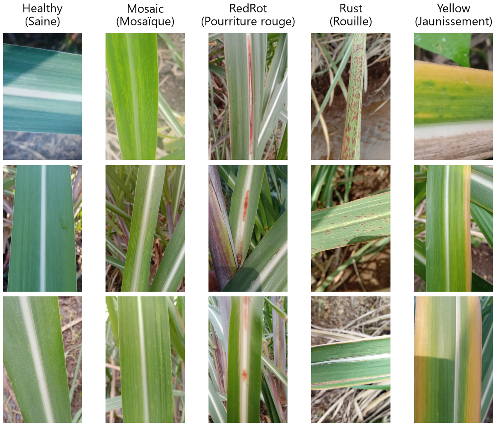
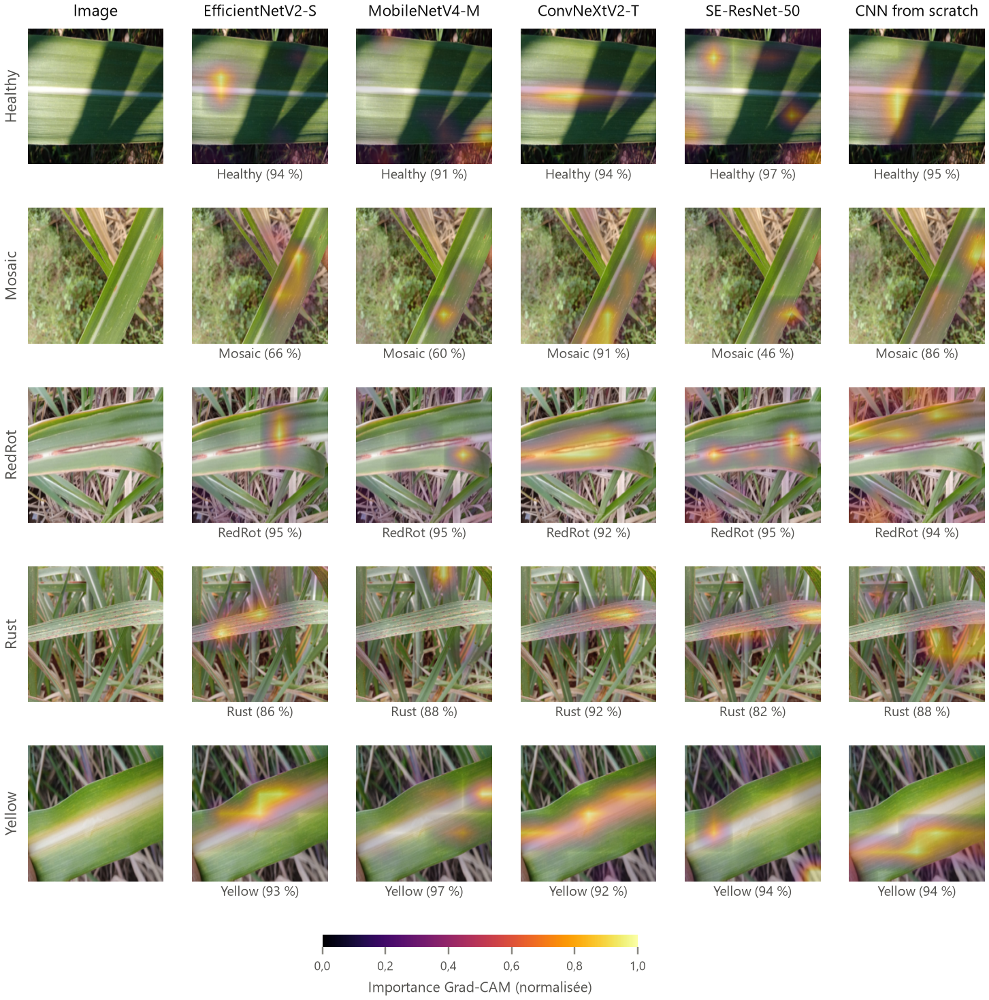

# Classification automatique des maladies des feuilles de canne à sucre

**Apprentissage profond et fusion de caractéristiques : extraction de caractéristiques, fine-tuning partiel et fine-tuning complet**

Projet 8 du module Deep Learning (Transfer Learning), Master ISI S3, Département d'Informatique,
Faculté des Sciences Semlalia, Université Cadi Ayyad, Marrakech. Année universitaire 2026-2027.

- Réalisé par : **Abderrahmane EL-HOUIJ**
- Encadré par : **Pr. Mustapha AATILA**

Le rapport complet (en français) se trouve dans [`rapport/main.pdf`](rapport/main.pdf).

## Objectif

Reconnaître automatiquement, à partir d'une photo de feuille prise au champ, si une canne à sucre est saine ou atteinte
de l'une de quatre maladies : mosaïque, pourriture rouge, rouille ou maladie de la feuille jaune. Le projet compare
quatre architectures pré-entraînées sur ImageNet et un CNN entraîné from scratch, trois stratégies d'apprentissage par
transfert et deux formes de fusion :

| Famille | Modèle utilisé (`timm`) | Paramètres | GFLOPs (224×224) |
|---|---|---|---|
| EfficientNetV2 | `tf_efficientnetv2_s.in1k` | 20,2 M | 5,70 |
| MobileNetV4 | `mobilenetv4_conv_medium.e500_r224_in1k` | 8,4 M | 1,65 |
| ConvNeXtV2 | `convnextv2_tiny.fcmae_ft_in1k` | 27,9 M | 8,91 |
| SENet | `seresnet50.ra2_in1k` | 26,1 M | 8,18 |
| CNN from scratch | 9 couches convolutives (`src/models.py`) | 1,2 M | 1,52 |

- **Extraction de caractéristiques (FE)** : réseau gelé, seule la tête de classification est apprise.
- **Fine-tuning partiel (PFT)** : le dernier étage du réseau (cartes 7×7) est ré-entraîné, le reste est gelé.
- **Fine-tuning complet (FFT)** : tout le réseau est ré-entraîné.
- **Fusion de caractéristiques** : concaténation des embeddings de 2, 3 ou 4 réseaux (les 15 combinaisons), à partir des
  réseaux ImageNet gelés ou des réseaux fine-tunés, ainsi qu'un vote souple des quatre modèles fine-tunés.

## Jeu de données

[Sugarcane Leaf Disease Dataset](https://www.kaggle.com/datasets/nirmalsankalana/sugarcane-leaf-disease-dataset)
(copie Kaggle du jeu publié par Daphal et Koli sur Mendeley Data, DOI 10.17632/9424skmnrk.1, licence CC BY 4.0) :
2 521 photos prises au smartphone dans le Maharashtra (Inde), 5 classes : `Healthy`, `Mosaic`, `RedRot`, `Rust`, `Yellow`.

L'audit réalisé par `prepare_data.py` a mis en évidence **210 doublons exacts** (184 groupes, dont 86 copies dans la
classe Mosaic) et **24 quasi-doublons** (même photo recadrée de quelques pixels). Ils sont supprimés **avant** le
découpage pour éviter qu'une image et sa copie se retrouvent dans l'apprentissage et dans le test. Le jeu final compte
2 287 images :

| Classe | Brut | Après nettoyage |
|---|---|---|
| Healthy | 522 | 472 |
| Mosaic | 462 | 376 |
| RedRot | 518 | 505 |
| Rust | 514 | 441 |
| Yellow | 505 | 493 |
| **Total** | **2 521** | **2 287** |

Protocole : 15 % des images (344) forment un ensemble de test tenu à l'écart ; les 1 943 autres sont réparties en
5 plis stratifiés pour la validation croisée (environ 1 554 images d'apprentissage et 389 de validation par pli).
Chaque modèle est entraîné 5 fois et évalué sur le même ensemble de test ; les résultats sont donnés en moyenne ±
écart-type sur les 5 plis.

## Résultats principaux

Accuracy sur l'ensemble de test (344 images), moyenne ± écart-type sur les 5 plis :

| Modèle | Extraction (FE) | Fine-tuning partiel | Fine-tuning complet |
|---|---|---|---|
| EfficientNetV2-S | 90,5 ± 0,9 % | 97,2 ± 0,7 % | 98,3 ± 0,5 % |
| MobileNetV4-M | 83,9 ± 0,7 % | 96,4 ± 0,7 % | 97,9 ± 0,4 % |
| ConvNeXtV2-T | 88,6 ± 0,9 % | 95,5 ± 0,7 % | **98,9 ± 0,6 %** |
| SE-ResNet-50 | 90,8 ± 0,8 % | 96,2 ± 0,9 % | 98,4 ± 0,8 % |
| CNN from scratch | | | 94,3 ± 2,1 % |

| Fusion | Embeddings ImageNet (gelés) | Embeddings fine-tunés |
|---|---|---|
| Meilleur réseau seul | 91,1 ± 1,0 % | 99,0 ± 0,6 % |
| Concaténation des 4 réseaux | 92,7 ± 0,5 % | 99,3 ± 0,6 % |
| Vote souple des 4 modèles fine-tunés | | **99,4 ± 0,5 %** |

En résumé :

- le fine-tuning complet l'emporte pour les quatre architectures, avec un gain de 7,6 à 14 points sur
  l'extraction de caractéristiques ; ConvNeXtV2-T est le meilleur modèle unique (F1 macro 98,9 %, AUC 0,9998) ;
- un petit CNN entraîné from scratch (94,3 %) dépasse l'extraction de caractéristiques, mais fait cinq fois plus
  d'erreurs que ConvNeXtV2-T fine-tuné ;
- la fusion des quatre réseaux fine-tunés réduit encore le taux d'erreur de moitié (99,3 à 99,4 %), un gain
  significatif d'après un bootstrap sur les images de test, mais pour trois fois plus de calcul ;
- MobileNetV4-M offre le meilleur compromis pour un téléphone : 97,9 % avec 8,4 M de paramètres, 1,65 GFLOPs
  et 30 ms par image sur CPU (contre 97 ms pour ConvNeXtV2-T) ;
- la classe Mosaic est la plus difficile pour tous les modèles ; les confusions restantes opposent surtout
  Mosaic et Healthy, RedRot et Rust, Yellow et RedRot.

Robustesse : sur des images de test dégradées (bruit, flou, assombrissement, compression JPEG, occultation),
ConvNeXtV2-T reste le plus robuste des modèles uniques (86,4 % d'accuracy en moyenne, contre 71,7 % pour
MobileNetV4-M). Après fine-tuning complet, MobileNetV4-M et SE-ResNet-50 s'effondrent face au bruit, alors que
leur fine-tuning partiel résiste bien mieux.

Besoin en données : avec seulement 25 % des images d'apprentissage (388 images), ConvNeXtV2-T fine-tuné
atteint 96,7 %, mieux que le CNN from scratch entraîné sur toutes les images (94,3 %) ; avec 10 % des images
(155), l'écart entre les deux atteint 20 points (91,5 % contre 71,5 %).

Les figures (courbes d'apprentissage, matrices de confusion, courbes ROC, Grad-CAM, etc.) sont dans
[`outputs/figures`](outputs/figures) et les tableaux dans [`outputs/tables`](outputs/tables).



Cartes Grad-CAM des modèles fine-tunés (une image de test par classe) : après fine-tuning, l'attention se porte sur
les lésions et la nervure centrale plutôt que sur l'arrière-plan.



## Organisation du dépôt

```
.
├── prepare_data.py      téléchargement, audit des doublons, découpage stratifié, cache 256x256
├── explore_data.py      figures et tableau de description du jeu de données
├── train.py             4 architectures x 3 stratégies + CNN from scratch, sur 5 plis
├── train_fusion.py      embeddings, têtes de fusion (15 combinaisons) et vote souple
├── benchmark.py         coût de calcul (paramètres, GFLOPs, latences) et robustesse
├── evaluate.py          tableaux LaTeX/CSV et figures
├── explain.py           cartes Grad-CAM
├── src/
│   ├── config.py        chemins, classes, hyperparamètres, choix des modèles
│   ├── data.py          chargement des images, plis, augmentation sur GPU
│   ├── models.py        réseaux pré-entraînés, CNN from scratch, stratégies, fusion
│   ├── engine.py        boucles d'entraînement et d'évaluation
│   ├── metrics.py       métriques, matrices de confusion, ROC
│   ├── gradcam.py       Grad-CAM
│   ├── plots.py         style des figures
│   └── utils.py         fonctions utilitaires
├── data/                splits.csv, rapport de nettoyage et statistiques (images non versionnées)
├── outputs/
│   ├── runs/            un dossier par modèle, stratégie et pli (historique, prédictions, résumé)
│   ├── benchmark/       coût de calcul et robustesse
│   ├── figures/         figures du rapport
│   └── tables/          tableaux du rapport
└── rapport/             rapport LaTeX (main.tex, sections/, figures/, tables/, references.bib)
```

## Installation

Python 3.10 ou plus récent. Il est conseillé d'installer d'abord PyTorch avec la version de CUDA adaptée à la carte
graphique (voir https://pytorch.org/get-started/locally/), par exemple :

```bash
python -m venv .venv
.venv\Scripts\activate            # Windows (sous Linux/macOS : source .venv/bin/activate)
pip install torch torchvision --index-url https://download.pytorch.org/whl/cu130
pip install -r requirements.txt
```

Les poids pré-entraînés sont téléchargés automatiquement depuis le Hugging Face Hub par `timm` lors de la première
exécution.

## Exécution

Les scripts s'exécutent dans l'ordre, depuis la racine du dépôt :

```bash
python prepare_data.py --download   # télécharge le jeu Kaggle, nettoie, découpe et met en cache
python explore_data.py              # figures de description du jeu de données
python train.py                     # 65 entraînements (environ 2 h 30 sur une RTX 5070 Laptop)
python train_fusion.py              # fusion des embeddings et vote souple
python benchmark.py                 # coût de calcul et robustesse
python train.py --models convnextv2_t mobilenetv4_m scratch_cnn --strategies full_finetuning --fractions 0.1 0.25 0.5
python evaluate.py                  # tableaux et figures
python explain.py                   # cartes Grad-CAM
```

La commande `train.py --fractions ...` correspond à l'étude du besoin en données : les mêmes modèles sont ré-entraînés
sur 10 %, 25 % et 50 % des images d'apprentissage de chaque pli (sous-échantillonnage stratifié).

Quelques options utiles :

```bash
python train.py --models convnextv2_t --strategies full_finetuning --folds 0
python train.py --epochs 5          # essai rapide
python benchmark.py --skip-robustness
```

Chaque entraînement terminé est sauvegardé dans `outputs/runs/<modèle>/<stratégie>/fold_<k>/`
(`history.csv`, `predictions.npz`, `summary.json` et `best.pt`) et n'est pas recalculé si l'on relance le script.
Les fichiers de poids (`best.pt`) ne sont pas versionnés à cause de leur taille ; les prédictions et résumés le sont,
ce qui permet de relancer `evaluate.py` sans refaire les entraînements.

## Choix techniques

- Mêmes conditions pour tous les modèles : images 224×224, lots de 32, 30 époques, AdamW (weight decay 0,05),
  taux d'apprentissage 1e-3 pour la tête et 1e-4 pour les couches pré-entraînées, échauffement de 2 époques puis
  décroissance cosinus, lissage des étiquettes 0,1, précision mixte bfloat16, mêmes graines et mêmes lots par pli.
- Tête commune à tous les modèles (LayerNorm, dropout 0,2, couche linéaire). La tête par défaut de `timm` pour les
  familles EfficientNet et MobileNet est initialisée dans ±1/√(nombre de classes), ce qui donne des logits énormes avec
  5 classes et pénalise artificiellement l'extraction de caractéristiques.
- Augmentation faite sur GPU par lots (recadrage, rotation ±15°, symétries, luminosité, contraste, légère saturation,
  pas de changement de teinte car la couleur est un symptôme). Les images restent en mémoire : sous Windows, les
  processus auxiliaires du `DataLoader` démarrent lentement et finissaient par bloquer l'entraînement.
- Normalisation intégrée comme première couche de chaque modèle, avec les statistiques de son pré-entraînement.

## Environnement utilisé

AMD Ryzen 9 8945HX, NVIDIA GeForce RTX 5070 Laptop GPU (8 Go), 32 Go de RAM, Windows 11 ; Python 3.12.13,
PyTorch 2.14.1 (CUDA 13.0), torchvision 0.29.1, timm 1.0.31, scikit-learn 1.9.1, NumPy 2.5.4, pandas 3.1.1,
Matplotlib 3.11.2.

## Références principales

- S. D. Daphal, S. M. Koli, *Sugarcane Leaf Disease Dataset*, Mendeley Data, 2022, doi:10.17632/9424skmnrk.1.
- M. Tan, Q. Le, *EfficientNetV2: Smaller Models and Faster Training*, ICML 2021.
- D. Qin et al., *MobileNetV4: Universal Models for the Mobile Ecosystem*, ECCV 2024.
- S. Woo et al., *ConvNeXt V2: Co-designing and Scaling ConvNets with Masked Autoencoders*, CVPR 2023.
- J. Hu, L. Shen, G. Sun, *Squeeze-and-Excitation Networks*, CVPR 2018.
- R. R. Selvaraju et al., *Grad-CAM: Visual Explanations from Deep Networks via Gradient-Based Localization*, ICCV 2017.
